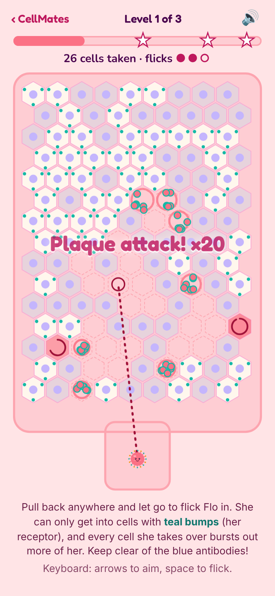

# CellMates 🦠

A cute virology game for the browser, and the sister game to [PetriPals](https://github.com/jessicasogge/petripals) and [FunGals](https://jessicasogge.github.io/fungals/). Bacteria and fungi grow on agar in a petri dish, but viruses can't: they need a living cell. Pick a real virus, find the cells with your receptor, take them over and burst out to spread across a cell culture flask.

**Status:** a playable prototype: three levels with Flo, the flu virus. See the [design doc](docs/design.md) for the plan.



## How to play

1. **Pull back and let go.** Press anywhere on the flask, pull back like a slingshot, and let go to flick Flo in from the neck. The dotted line shows about where she'll land. (On a keyboard: the arrow keys aim and the space bar flicks.)
2. **Land on the right cell.** Viruses can't swim, so once she's flicked, she just drifts. She can only get into cells with **teal bumps**: her receptor, sialic acid.
3. **Watch it spread.** The cell makes copies of her and bursts, and the new virions drift off to land on the cells around it. One good flick can set off a long chain. Each burst cell leaves a clear hole, a **plaque**.
4. **Take over the flask.** You get three flicks. Fill the meter to the stars: one star beats the level, and three is a perfect flask. Virions that drift into the blue **antibody** clouds are stopped.

Every level lays its cells out the same way each time, and your aim stays put, so **Try again** (or the R key) is a fair rematch.

## Running it locally

The game is plain HTML, CSS and JavaScript in [`public/`](public/), with no build step. To run it with the included dev server:

```sh
npm install
npm run dev
```

Then open http://localhost:3000.

## Tests

```sh
npm test                # run the tests
npm run test:coverage   # run them and check how much of the game they cover
```

The tests use [Vitest](https://vitest.dev/), and most run in [jsdom](https://github.com/jsdom/jsdom), a simulated browser page. The coverage check fails if the tests leave game code untested (the thresholds are in [`vitest.config.js`](vitest.config.js)), and the deploy runs it, so untested code doesn't ship.

## Project layout

| Path | What's there |
|---|---|
| `public/index.html` | Home page, with its row of pals drawn by `script.js` |
| `public/flask.html` | The game page; `game/play.js` runs it |
| `public/game/config.js` | The numbers the game is built on: the flask, how virions drift, Flo's life cycle and the levels |
| `public/game/infect.js` | The game itself, with no drawing: cells, drifting virions, attach → copy → burst |
| `public/game/hex.js` | The hexagonal grid of cells |
| `public/game/aim.js` | Aiming the flick, by pulling back or with the arrow keys |
| `public/game/draw.js` | Drawing the flask on a canvas |
| `public/game/sound.js` | The pop of a bursting cell, a note higher for each one in a chain |
| `public/game/pals.js` | Every pal's name and drawing, in one place. So far: Tess (phage T4), Flo (influenza A), Rota (rotavirus) and Cora (coronavirus) |
| `public/game/` | Game code carried over from PetriPals: steering with the arrow keys (`keyboard.js`) and by touch or mouse (`touch.js`), the fun-fact pop-up (`facts.js`, with italics for scientific names from `italics.js`), and the win confetti (`spores.js`, using canvas-confetti in `vendor/`) |
| `docs/design.md` | The design doc |
| `test/` | Tests |
| `scripts/simulate.mjs` | Plays every level many times with a computer player, to help tune the levels (`node scripts/simulate.mjs`) |
| `src/index.ts` | Small Express server for local development |

## Deployment

Every push to `main` runs the tests and the coverage check and, if they pass, publishes `public/` to GitHub Pages (see [`.github/workflows/pages.yml`](.github/workflows/pages.yml)). Turn on Pages for the repo first, with GitHub Actions as the source.

## Contributing

Bug reports, ideas and fixes are welcome! See [CONTRIBUTING.md](CONTRIBUTING.md) for how to get started, and please follow the [Code of Conduct](CODE_OF_CONDUCT.md).

## License

CellMates is released under the [MIT License](LICENSE). The confetti uses [canvas-confetti](https://github.com/catdad/canvas-confetti), which is ISC licensed ([`public/game/vendor/confetti.LICENSE`](public/game/vendor/confetti.LICENSE)). The home page uses the [Fredoka](https://github.com/hafontia/Fredoka-One) and [Nunito](https://github.com/googlefonts/nunito) fonts, under the SIL Open Font License ([`public/fonts/`](public/fonts/)).

## Credits

Made by Jessica Sogge.
