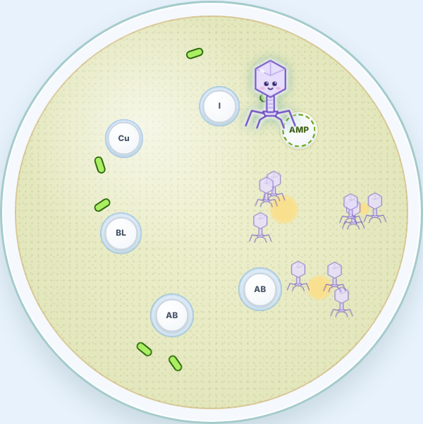

# CellMates 🦠

A cute virology game for the browser, and the sister game to [PetriPals](https://github.com/jessicasogge/petripals) and [FunGals](https://github.com/jessicasogge/fungals). Bacteria and fungi grow on their own, but viruses can't: they need a living cell. Pick a real virus, get inside bacteria and burst them open to make copies of her.

**[▶ Play CellMates](https://jessicasogge.github.io/cellmates/)**: works on computers, phones and tablets.



## How to play: Plaque Assay

1. **Pick a mate.** Each one is a real virus, drawn as a cartoon. So far they're all bacteriophages: viruses that infect bacteria.
2. **Move around the dish.** Use the arrow keys, or on a touch screen, drag like a trackpad, just like PetriPals and FunGals.
3. **Touch an *E. coli* cell to get inside it.** She's stuck in there while the cell swells and blushes, then it bursts open and she comes out with new copies of her, leaving a clear hole in the lawn: a **plaque**. The copies drift off and get into cells they bump into on their own (a copy that does is used up), and those cells burst with more copies.

Make enough copies of her to finish the level, counting every copy that bursts out, her copies' copies included. There are seven levels, and each doubles the copies you need, from 4 up to 256. There's nothing to dodge, so no way to lose.

## The mates

| Mate | Virus | Looks | In the dish |
|---|---|---|---|
| **Tia** | Bacteriophage T4 | Lavender lunar lander: a gem-shaped head on a striped tail, on long, bendy legs | Bursts with 3 copies, after 1.5 seconds |
| **Phoebe** | Bacteriophage φX174 | Little teal twenty-sided gem with no tail and a knobby spike on every corner | Bursts fastest (1.1 seconds), with 2 copies |
| **Missy** | Bacteriophage MS2 | Small, round, bumpy coral shell with one little tab on top | Bursts slowest (2 seconds), with 4 copies |

All three infect *Escherichia coli*, so the cells in the lawn are drawn and sized like Colette's offspring in PetriPals: pale green-apple rods with flagella all around. Healthy cells glide very slowly, wandering a little; an infected one stops.

## The real science

- **The plaque assay** is how virologists count viruses. They spread bacteria (or animal cells) over a plate so thickly they grow into one smooth, cloudy layer, a **lawn**, and add a little virus. Each virus infects a cell, which bursts with copies that infect its neighbors, and so on, until there's a clear hole in the lawn: a **plaque**. Every plaque started from one virus, so counting plaques counts viruses. That's the clear amber agar showing through where cells burst in the game. Real plaques take hours to grow, not seconds.
- **Phages are much smaller than bacteria.** An *E. coli* cell is about 2 micrometers long. T4 is about a tenth of that, and φX174 and MS2 are only about 25 nanometers across, so about 80 of them would fit along one cell. In the game every mate is smaller than the cells, and Tia is bigger than Phoebe and Missy, but true to scale they'd be too small to see.
- **Viruses can't swim.** They have no way to move on their own, so they drift and bump into cells by chance. In the game you steer her anyway, and her copies just drift.
- **Burst sizes** are scaled way down. A cell infected by T4 really bursts with about 100 to 200 copies, φX174 about as many, and MS2 thousands. In the game they're 3, 2 and 4, and her **latent period** (how long a cell takes to burst, while she's inside) is 1 to 2 seconds, where the real ones are tens of minutes.
- **Tia's legs** are her six long tail fibers. She lands on *E. coli* with them, then her tail squeezes down and drives a tube through the cell's wall, and she injects her DNA, leaving her empty head and tail outside.
- **Phoebe's spikes** are on all 12 corners of her shell. φX174 was the first DNA genome ever read from end to end (Fred Sanger's lab, 1977), and in 2003 scientists built its genome from scratch in two weeks, and it worked.
- **Missy's tab** is her one maturation protein, which grabs the F pilus, a long hair some *E. coli* cells grow. MS2's genome is RNA, and in 1976 it was the first genome of any kind ever read in full.

## Running it locally

The game is plain HTML, CSS and JavaScript in [`public/`](public/), with no build step. To run it with the included dev server:

```sh
npm install
npm run dev
```

Then open http://localhost:3005.

## Tests

```sh
npm test                # run the tests
npm run test:coverage   # run them and check how much of the game they cover
```

The tests use [Vitest](https://vitest.dev/), and most run in [jsdom](https://github.com/jsdom/jsdom), a simulated browser page. The coverage check fails if the tests leave game code untested (the thresholds are in [`vitest.config.js`](vitest.config.js)), and the deploy runs it, so untested code doesn't ship.

## Project layout

CellMates started from the FunGals engine (steering, the loading card, the end-of-level pop-up and the win confetti), with the fungi swapped for viruses and the nutrients for a lawn of cells.

| Path | What's there |
|---|---|
| `public/index.html` | Home page, with its row of mates drawn by `script.js` |
| `public/pick-a-mate.html` | Pick a mate (`game/picker.js`) |
| `public/petri-dish.html` | The game; `game/main.js` starts it |
| `public/game/config.js` | Every mate's settings and facts, the levels, and the numbers the game is built on |
| `public/game/mates.js` | Every mate's name and drawing, in one place. To add a mate, see the notes at the top. |
| `public/game/game.js` | The game loop: steering and winning |
| `public/game/swarm.js` | Her and her copies: infecting, bursting out and drifting |
| `public/game/hosts.js` | The lawn: *E. coli* cells, infected cells bursting, and plaques |
| `public/game/` | Also: steering with the arrow keys (`keyboard.js`) and by touch or mouse (`touch.js`), the end-of-level pop-up (`banner.js`), the fun-fact pop-up (`facts.js`, with italics from `italics.js`), the loading card (`loading.js`), visit counting (`track.js`) and the win confetti (`spores.js`, using canvas-confetti in `vendor/`) |
| `test/` | Tests |
| `src/index.ts` | Small Express server for local development |

## Deployment

Every push to `main` runs the tests and the coverage check and, if they pass, publishes `public/` to GitHub Pages (see [`.github/workflows/pages.yml`](.github/workflows/pages.yml)).

## Contributing

Bug reports, ideas and fixes are welcome! See [CONTRIBUTING.md](CONTRIBUTING.md) for how to get started, and please follow the [Code of Conduct](CODE_OF_CONDUCT.md).

## License

CellMates is released under the [MIT License](LICENSE). The confetti uses [canvas-confetti](https://github.com/catdad/canvas-confetti), which is ISC licensed ([`public/game/vendor/confetti.LICENSE`](public/game/vendor/confetti.LICENSE)). The home page uses the [Fredoka](https://github.com/hafontia/Fredoka-One) and [Nunito](https://github.com/googlefonts/nunito) fonts, under the SIL Open Font License ([`public/fonts/`](public/fonts/)).

## Credits

Made by Jessica Sogge.
