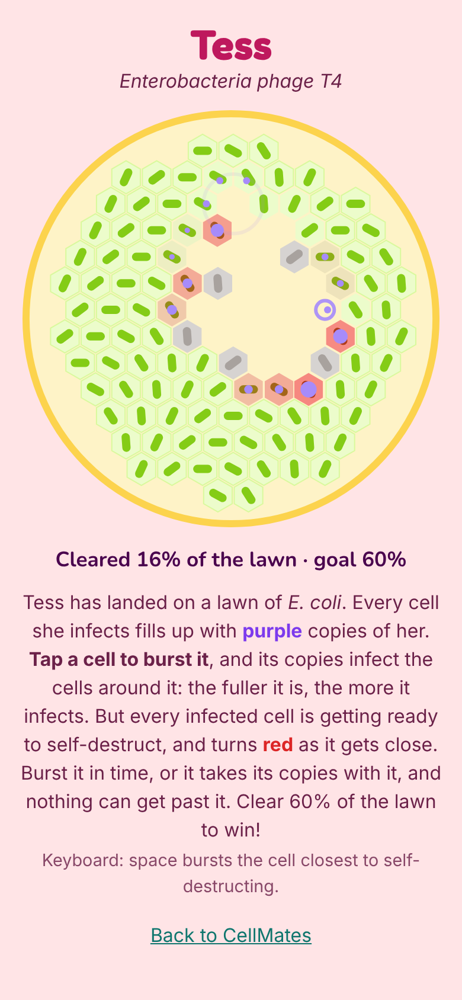

# CellMates 🦠

A cute virology game for the browser, and the sister game to [PetriPals](https://github.com/jessicasogge/petripals) and [FunGals](https://jessicasogge.github.io/fungals/). Bacteria and fungi grow on agar in a petri dish, but viruses can't: they need a living cell. Pick a real virus, find the cells with your receptor, take them over and burst out to spread across a cell culture flask.

**Status:** a playable prototype of one game, **Plaque**, with Tess the phage. See the [design doc](docs/design.md) for the bigger plan.



## How to play

You're **Tess**, a T4 phage: a virus that infects bacteria. She lands on a petri dish covered in a lawn of *E. coli*.

1. **Watch the cells fill up.** Every cell she infects fills with purple copies of her.
2. **Tap a cell to burst it.** Its copies infect the cells around it, and the fuller it is, the more it infects. A burst cell leaves a clear hole in the lawn, called a **plaque**. (On a keyboard, the space bar bursts the cell closest to self-destructing.)
3. **Don't wait too long.** Every infected cell is also getting ready to self-destruct, and turns red and shakes as it gets close. If it self-destructs first, its copies are lost, and nothing can get past it.
4. **Clear 60% of the lawn to win.** Soon there are lots of cells going at once, so the game is in choosing which to burst first.

### The real science

Plaques are real: it's how scientists grow and count phages, by spreading them on a lawn of bacteria and counting the clear spots. Some bacteria really do self-destruct when a phage gets in (*abortive infection*), which is exactly why it helps them: the phage dies too, and can't reach the neighbors. The numbers are real-sized: a T4 makes about 100 to 200 copies in one cell. Only the time is sped up, about ten real minutes to a second.

## Running it locally

The game is plain HTML, CSS and JavaScript in [`public/`](public/), with no build step. To run it with the included dev server:

```sh
npm install
npm run dev
```

Then open http://localhost:3000.

## Tests

```sh
npm test                # run the tests
npm run test:coverage   # run them and check how much of the game they cover
```

The tests use [Vitest](https://vitest.dev/), and most run in [jsdom](https://github.com/jsdom/jsdom), a simulated browser page. The coverage check fails if the tests leave game code untested (the thresholds are in [`vitest.config.js`](vitest.config.js)), and the deploy runs it, so untested code doesn't ship.

## Project layout

| Path | What's there |
|---|---|
| `public/index.html` | Home page, with its row of pals drawn by `script.js` |
| `public/plaque.html` | The Plaque page; `game/play.js` runs it |
| `public/game/config.js` | The numbers the game is built on: the dish, Tess's life cycle and how the lawn fights back |
| `public/game/lawn.js` | The game itself, with no drawing: infecting, filling up, bursting and self-destructing |
| `public/game/hex.js` | The hexagonal grid of bacteria |
| `public/game/draw.js` | Drawing the dish on a canvas |
| `public/game/pals.js` | Every pal's name and drawing, in one place. So far: Tess (phage T4), Flo (influenza A), Rota (rotavirus) and Cora (coronavirus) |
| `public/game/` | Game code carried over from PetriPals: steering with the arrow keys (`keyboard.js`) and by touch or mouse (`touch.js`), the fun-fact pop-up (`facts.js`, with italics for scientific names from `italics.js`), and the win confetti (`spores.js`, using canvas-confetti in `vendor/`) |
| `docs/design.md` | The design doc |
| `test/` | Tests |
| `scripts/simulate.mjs` | Plays thousands of runs with simple computer players, to help tune `config.js` (`node scripts/simulate.mjs`) |
| `src/index.ts` | Small Express server for local development |

## Deployment

Every push to `main` runs the tests and the coverage check and, if they pass, publishes `public/` to GitHub Pages (see [`.github/workflows/pages.yml`](.github/workflows/pages.yml)). Turn on Pages for the repo first, with GitHub Actions as the source.

## Contributing

Bug reports, ideas and fixes are welcome! See [CONTRIBUTING.md](CONTRIBUTING.md) for how to get started, and please follow the [Code of Conduct](CODE_OF_CONDUCT.md).

## License

CellMates is released under the [MIT License](LICENSE). The confetti uses [canvas-confetti](https://github.com/catdad/canvas-confetti), which is ISC licensed ([`public/game/vendor/confetti.LICENSE`](public/game/vendor/confetti.LICENSE)). The home page uses the [Fredoka](https://github.com/hafontia/Fredoka-One) and [Nunito](https://github.com/googlefonts/nunito) fonts, under the SIL Open Font License ([`public/fonts/`](public/fonts/)).

## Credits

Made by Jessica Sogge.
