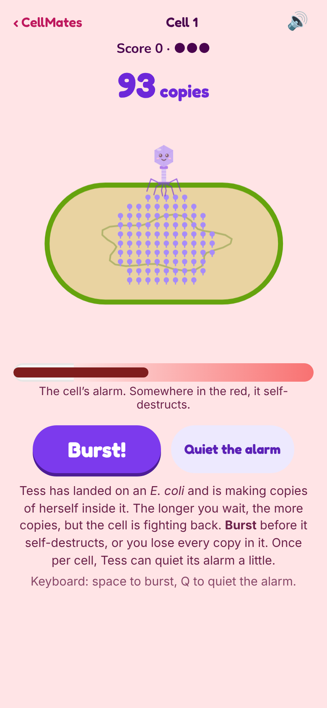

# CellMates 🦠

A cute virology game for the browser, and the sister game to [PetriPals](https://github.com/jessicasogge/petripals) and [FunGals](https://jessicasogge.github.io/fungals/). Bacteria and fungi grow on agar in a petri dish, but viruses can't: they need a living cell. Pick a real virus, find the cells with your receptor, take them over and burst out to spread across a cell culture flask.

**Status:** a playable prototype of one game, **Burst or Wait**, with Tess the phage. See the [design doc](docs/design.md) for the bigger plan.



## How to play

You're **Tess**, a T4 phage: a virus that infects bacteria. She lands on an *E. coli* and injects her DNA, and the cell starts building copies of her.

1. **Wait.** After a short wait (the "eclipse", while only her DNA is being copied), whole copies start piling up, and the counter climbs.
2. **Watch the alarm.** The cell is fighting back. Its alarm rises, sometimes in sudden jumps, and somewhere in the red zone it self-destructs, taking every copy with it. You can't see exactly where.
3. **Burst!** Tap **Burst** (or the cell, or the space bar) to break it open and add its copies to your score. Once per cell, **Quiet the alarm** (or Q) knocks the alarm back a little.
4. **Keep going.** Each bacterium you burst, the next is a bit tougher. When three cells have self-destructed on you, the run is over. Beat your best!

After every cell, the meter shows where its breaking point really was, so you can see how close you came, or how much longer you could have waited.

### The real science

Real phages face the same choice. Bursting later means more copies per cell but slower spreading, and each kind of phage has evolved its own best time to burst. Some bacteria really do self-destruct when a phage gets in (*abortive infection*), and phages like T4 really do carry proteins (such as Dmd) that switch some of those defenses off. The numbers are real-sized too: a T4 makes about 100 to 200 copies in one cell. Only the time is sped up, about ten real minutes to a second.

## Running it locally

The game is plain HTML, CSS and JavaScript in [`public/`](public/), with no build step. To run it with the included dev server:

```sh
npm install
npm run dev
```

Then open http://localhost:3000.

## Tests

```sh
npm test                # run the tests
npm run test:coverage   # run them and check how much of the game they cover
```

The tests use [Vitest](https://vitest.dev/), and most run in [jsdom](https://github.com/jsdom/jsdom), a simulated browser page. The coverage check fails if the tests leave game code untested (the thresholds are in [`vitest.config.js`](vitest.config.js)), and the deploy runs it, so untested code doesn't ship.

## Project layout

| Path | What's there |
|---|---|
| `public/index.html` | Home page, with its row of pals drawn by `script.js` |
| `public/cell.html` | The Burst or Wait page; `game/play.js` runs it |
| `public/game/config.js` | The numbers the game is built on: Tess's life cycle and how the host cell fights back |
| `public/game/cell.js` | The game itself, with no drawing: copying, the alarm, bursting and self-destructing |
| `public/game/draw.js` | Drawing the bacterium on a canvas |
| `public/game/sound.js` | The pop of new copies, climbing up a scale as they pile up |
| `public/game/pals.js` | Every pal's name and drawing, in one place. So far: Tess (phage T4), Flo (influenza A), Rota (rotavirus) and Cora (coronavirus) |
| `public/game/` | Game code carried over from PetriPals: steering with the arrow keys (`keyboard.js`) and by touch or mouse (`touch.js`), the fun-fact pop-up (`facts.js`, with italics for scientific names from `italics.js`), and the win confetti (`spores.js`, using canvas-confetti in `vendor/`) |
| `docs/design.md` | The design doc |
| `test/` | Tests |
| `scripts/simulate.mjs` | Plays thousands of runs with simple computer players, to help tune `config.js` (`node scripts/simulate.mjs`) |
| `src/index.ts` | Small Express server for local development |

## Deployment

Every push to `main` runs the tests and the coverage check and, if they pass, publishes `public/` to GitHub Pages (see [`.github/workflows/pages.yml`](.github/workflows/pages.yml)). Turn on Pages for the repo first, with GitHub Actions as the source.

## Contributing

Bug reports, ideas and fixes are welcome! See [CONTRIBUTING.md](CONTRIBUTING.md) for how to get started, and please follow the [Code of Conduct](CODE_OF_CONDUCT.md).

## License

CellMates is released under the [MIT License](LICENSE). The confetti uses [canvas-confetti](https://github.com/catdad/canvas-confetti), which is ISC licensed ([`public/game/vendor/confetti.LICENSE`](public/game/vendor/confetti.LICENSE)). The home page uses the [Fredoka](https://github.com/hafontia/Fredoka-One) and [Nunito](https://github.com/googlefonts/nunito) fonts, under the SIL Open Font License ([`public/fonts/`](public/fonts/)).

## Credits

Made by Jessica Sogge.
